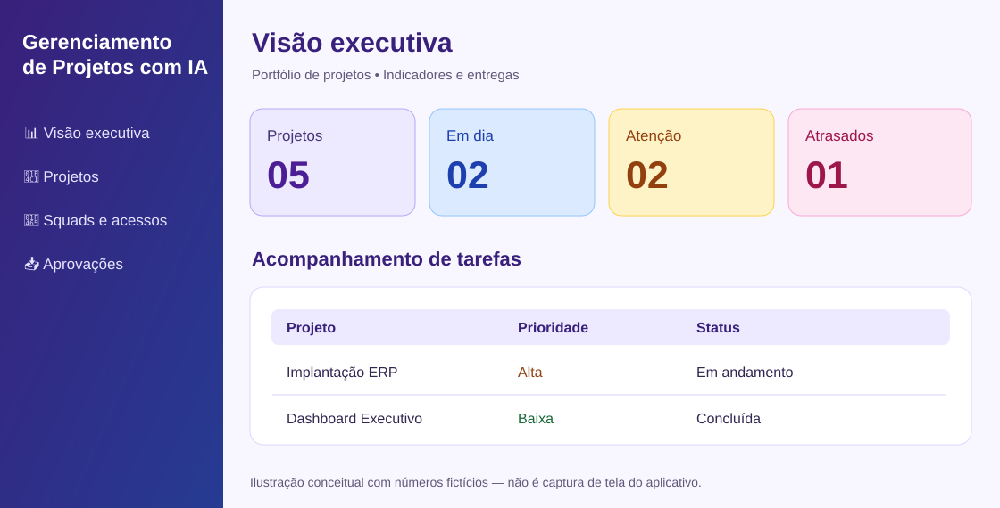
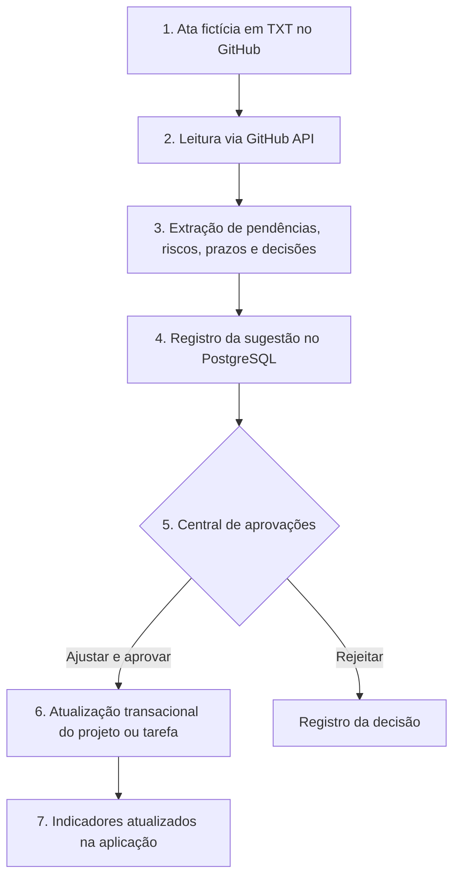
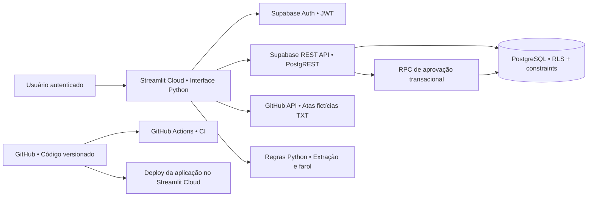
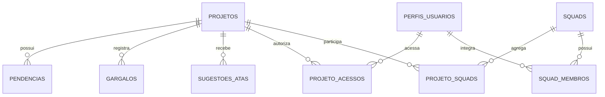
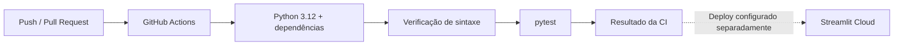

<div align="center">

# 💜💙 Gerenciamento de Projetos com IA
### Portfólio de projetos • Governança de dados • Aprovação de mudanças a partir de atas

**Aplicação web em Python, Streamlit e PostgreSQL (Supabase)**

[🚀 Acessar demonstração](https://projectflow-ai-karol.streamlit.app/) · [🗃️ Modelagem de dados](docs/modelagem-dados.md) · [⚙️ Pipeline CI](.github/workflows/ci.yml)


</div>

## 🔌 MCP — estrutura cliente e servidor (modo demonstração)

O projeto inclui um **MCP Server** e um **MCP Client** com transporte local `stdio`, ferramentas de consulta e testes automatizados, usando **dados sintéticos**. A aplicação em produção não foi conectada a esse servidor demo. **SharePoint e Teams são integrações futuras**, planejadas via Microsoft Graph e OAuth.

- [Arquitetura MCP, desenho, segurança, testes e roadmap](docs/arquitetura-mcp.md)
- Validar localmente: `pip install -r requirements-mcp.txt && python -m pytest -q tests/test_mcp_catalog.py tests/test_mcp_integration.py`
- Executar cliente de exemplo: `python -m mcp_projectflow.client`

## 🎯 Sobre o projeto

Gerenciar vários projetos exige acompanhar **prazos, responsáveis, pendências, riscos, equipes e decisões tomadas em reuniões**. Quando essas informações ficam espalhadas em planilhas e atas, a atualização do portfólio pode se tornar lenta e sujeita a inconsistências.

O **Gerenciamento de Projetos com IA** (nome técnico original: *ProjectFlow AI*) é um **MVP de aplicação web** criado para centralizar o acompanhamento e propor atualizações a partir de atas de reunião, **sempre com revisão humana antes de gravar mudanças**.

**O que o projeto demonstra em um processo seletivo:** visão de produto, integração de sistemas, desenvolvimento Python, modelagem relacional, autenticação e autorização, automação de processos, governança de mudanças, indicadores de gestão e práticas de entrega contínua.

> **Transparência técnica:** o nome inclui “IA” por refletir a visão do produto, mas **a extração atual das atas é baseada em regras textuais em Python, não em um modelo de linguagem (LLM)**. O sistema não toma decisões autônomas sobre o portfólio. Integração com IA generativa é uma oportunidade futura, não uma capacidade anunciada como pronta.

## 🖥️ Conheça a interface

### Visão executiva — referência visual



*Ilustração conceitual da interface, com dados fictícios. Não é uma captura real do sistema. Para visualizar as telas atuais e interagir, abra a [demonstração online](https://projectflow-ai-karol.streamlit.app/). O acesso às páginas internas requer usuário autorizado.*

### Principais telas e recursos

| Tela | O que permite fazer |
|---|---|
| 📊 **Visão executiva** | Consultar indicadores de projetos, farol de prazos, tarefas, prioridades, entregas e cronograma |
| 📁 **Detalhes do projeto** | Visualizar responsáveis, pendências, gargalos, histórico e contexto do projeto |
| 🤖 **Análise de atas** | Buscar atas fictícias no GitHub, extrair trechos por categoria e comparar reuniões |
| 📥 **Central de aprovações** | Consolidar sugestões de vários projetos, revisar, ajustar, aprovar ou rejeitar |
| 📝 **Gerenciar projetos** | Cadastrar e atualizar projetos e pendências conforme permissões |
| 👥 **Squads e acessos** | Consultar squads, papéis e projetos autorizados |
| 🔒 **Minha conta** | Alterar a senha; a tela de entrada permite solicitar recuperação por e-mail |

**Design:** identidade *Purple Tech* em roxo, azul e lavanda, com diferenciação visual de prioridades, status e tipos de projeto.

## 🔁 Fluxo funcional: da reunião ao dashboard



**Controles importantes:**
- A sugestão guarda referência ao arquivo e trecho de origem.
- Uma chave única ajuda a impedir sugestões duplicadas do mesmo trecho.
- O administrador define o destino da atualização: nova pendência, gargalo, prazo do projeto, responsável ou tarefa existente, conforme o tipo de sugestão.
- A aplicação da alteração e a decisão de aprovação são processadas juntas no banco.
- O processo de busca ocorre quando a central é aberta ou atualizada; **não é um robô agendado em segundo plano**.

## 🏗️ Arquitetura da solução



**Decisões de arquitetura:** frontend e orquestração em Streamlit; regras de negócio em módulos Python; persistência relacional no PostgreSQL; autenticação delegada ao Supabase Auth; acesso aos registros limitado por **Row Level Security (RLS)**; atas públicas restritas a **dados fictícios**.

## 🧰 Tecnologias, linguagens e ferramentas

| Camada | Tecnologia | Uso no projeto |
|---|---|---|
| Linguagem | **Python** | Interface, regras de negócio, integração HTTP e processamento de atas |
| Interface web | **Streamlit 1.51.0** | Páginas, filtros, formulários, cards e dashboards |
| Visualização | **Pandas e Altair** | Tratamento de dados, tabelas e gráficos |
| Estilo | **HTML e CSS** | Componentes visuais e identidade Purple Tech |
| Banco de dados | **PostgreSQL (Supabase)** | Modelo relacional, relacionamentos, restrições, transações e RLS |
| Identidade | **Supabase Auth** | Login, sessões JWT, recuperação e alteração de senha |
| Integrações | **REST APIs / HTTP / JSON / requests** | Acesso ao Supabase e leitura das atas via GitHub |
| Versionamento | **Git e GitHub** | Código-fonte, histórico e documentação |
| Testes | **pytest 8.4.2** | Testes automatizados das regras de farol |
| CI | **GitHub Actions** | Verificação de sintaxe e execução dos testes em push/PR |
| Hospedagem | **Streamlit Community Cloud** | Publicação da interface web |

**Nota:** `supabase==2.22.0` consta em `requirements.txt`; as chamadas de autenticação e dados verificadas em `app.py` usam principalmente requisições HTTP via `requests`. Não há evidência de uso de JavaScript/Node.js como camada de aplicação, nem de Power BI integrado à versão atual.

## 🗃️ Banco de dados e modelagem

**Tipo:** PostgreSQL **relacional (OLTP)**, hospedado no Supabase. O modelo organiza dados de projeto, execução, colaboração e autorização sem misturar identidades com tarefas.



**Tabelas principais:** `projetos`, `pendencias`, `gargalos`, `atas`, `historico`, `sugestoes_atas`, `perfis_usuarios`, `squads`, `squad_membros`, `projeto_acessos` e `projeto_squads`.

O banco utiliza **PKs, FKs, tabelas associativas, restrições CHECK, campos de data e timestamps, índices de unicidade e políticas RLS**. A aprovação de sugestões utiliza uma função transacional no PostgreSQL.

➡️ **[Veja o diagrama completo, regras e evolução analítica proposta](docs/modelagem-dados.md).**

**Evolução de engenharia de dados:** um **modelo dimensional em estrela** para BI histórico foi desenhado como proposta (fatos de tarefas e decisões; dimensões de projeto, data, status e prioridade). **Ainda não foi implementado**, preservando a separação entre banco operacional e camada analítica.

## 🔐 Segurança e governança

- Autenticação por e-mail/senha via **Supabase Auth** e tokens JWT.
- **RLS** nas tabelas de domínio; acesso conforme perfil e vínculos autorizados.
- Papéis por projeto e participação em squads modelados em tabelas associativas.
- Propostas de alteração sujeitas à revisão do administrador; operação de aprovação transacional.
- Credenciais configuradas em **Streamlit Secrets**, não no repositório público.
- Atas do repositório são **fictícias**. Não publique atas corporativas, dados pessoais ou segredos no GitHub.
- Princípios de **LGPD** considerados no desenho de acesso e minimização; **isso não equivale a uma certificação ou auditoria formal de conformidade**.

## 🧪 Pipeline CI/CD e qualidade

O repositório já contém um workflow de **integração contínua** em [`.github/workflows/ci.yml`](.github/workflows/ci.yml), acionado por `push` e `pull_request` na branch `main`:



O workflow verifica sintaxe de `app.py`, `farol.py`, `atas_github.py` e testes; em seguida executa `pytest`. **Não há, neste workflow, uma etapa que faça deploy ou testes end-to-end da interface**; a publicação é feita pela integração do Streamlit Cloud com o repositório.

## 🧭 Como o projeto foi construído

1. **Problema de negócio:** consolidar informações de vários projetos, evitando acompanhamento fragmentado.
2. **MVP e regras:** estruturar projetos, tarefas, indicadores de farol e visão executiva.
3. **Persistência:** modelar entidades e relacionamentos no PostgreSQL do Supabase.
4. **Identidade e acessos:** adicionar autenticação individual, perfis, squads, vínculos por projeto e RLS.
5. **Integração com atas:** consumir arquivos de demonstração via GitHub API e extrair categorias textuais.
6. **Governança:** criar fila central de sugestões com revisão, ajustes, rejeição e aplicação transacional.
7. **Experiência do usuário:** evoluir interface, cards, cores, contraste, navegação e ícones com a identidade Purple Tech.
8. **Engenharia e documentação:** testes automatizados, pipeline CI e documentação de arquitetura/modelagem.

O desenvolvimento é **incremental**, com validações de interface e ajustes de regras conforme os fluxos de uso.

## ▶️ Executar localmente

**Pré-requisitos:** Python 3.11+ e acesso a um projeto Supabase configurado com as tabelas, políticas e usuários necessários.

```bash
git clone https://github.com/karolcastro/Reprograma_IA_Agente_de_Projetos.git
cd Reprograma_IA_Agente_de_Projetos
python -m venv .venv
source .venv/bin/activate
pip install -r requirements.txt
```

No Windows, ative o ambiente com `.venv\\Scripts\\activate`.

Crie **localmente**, sem versionar, o arquivo `.streamlit/secrets.toml`:

```toml
SUPABASE_URL = "https://SEU-PROJETO.supabase.co"
SUPABASE_PUBLISHABLE_KEY = "SUA_CHAVE_PUBLICAVEL"
```

Depois execute:

```bash
streamlit run app.py
```

**Atenção:** apenas configurar as duas variáveis **não cria o schema** nem as políticas de autorização. A instância Supabase precisa estar previamente preparada. Não use `service_role` ou chaves secretas no cliente. O envio de recuperação de senha também depende da configuração de e-mail no Supabase Auth.

Para executar os testes:

```bash
python -m pytest -q
```

## 🗂️ Estrutura do código

```text
.
├── app.py                     # Interface Streamlit, páginas e integração Supabase
├── atas_github.py             # Leitura e extração de atas fictícias
├── farol.py                   # Regras de status dos projetos
├── dados_exemplo/atas/        # Atas fictícias de demonstração
├── tests/test_farol.py        # Testes automatizados
├── docs/
│   ├── modelagem-dados.md     # Modelo relacional e proposta dimensional
│   └── visao-executiva-ilustrativa.svg
├── .github/workflows/ci.yml  # Pipeline de integração contínua
├── requirements.txt
└── README.md
```

## 🛣️ Próximas evoluções (não implementadas)

- Classificação explícita de tipo de projeto no cadastro, sem inferência pelo nome.
- Extração contextual com LLM e avaliação de qualidade das sugestões.
- Identificação automática da tarefa correspondente a cada trecho, com confirmação humana.
- Ingestão segura de atas privadas, com armazenamento apropriado e controle de retenção.
- Histórico analítico e data mart dimensional para BI.
- Ampliação de testes de integração, autenticação e interface.
- Melhorias adicionais de acessibilidade e observabilidade.

## 👩‍💻 Autoria

**Karoliny de Castro** — Engenharia de Dados, Business Intelligence, Integração de Sistemas e Gestão de Projetos de TI.

Projeto de portfólio com foco em **transformar necessidades de negócio em soluções de tecnologia, dados e processos**, com atenção à governança, rastreabilidade e experiência do usuário.

---

<div align="center"><sub>Projeto demonstrativo em evolução • Dados fictícios nas atas públicas • Desenvolvido com Python, Streamlit, PostgreSQL/Supabase e GitHub.</sub></div>
