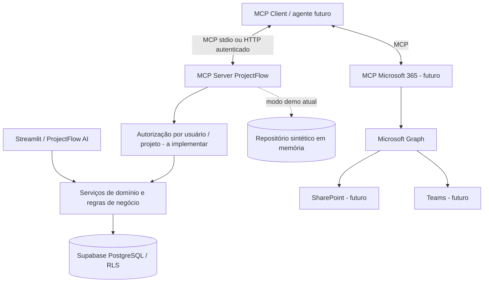

# ProjectFlow AI — Arquitetura MCP (fase 1)

**Status:** estrutura implementada em modo de demonstração local. Integrações corporativas **não conectadas**.

## Objetivo

Preparar o ProjectFlow AI para atuar como **MCP Server** (expondo capacidades autorizadas para outros clientes/agentes) e **MCP Client** (consumindo ferramentas de outros servidores), sem depender agora de uma conta Microsoft 365 corporativa.

## Desenho da arquitetura



**Separação essencial:** o servidor demo atual usa apenas `DemoRepository`. Não acessa Supabase, Teams ou SharePoint e não deve ser exposto publicamente. O Streamlit em produção permanece independente.

## Entregas atuais verificáveis

- `mcp_projectflow/server.py`: servidor MCP **stdio**, ferramentas `listar_projetos` e `consultar_projeto` e recurso `projectflow://demo/capabilities`, somente leitura.
- `mcp_projectflow/client.py`: cliente MCP que inicializa sessão, descobre ferramentas e invoca uma delas.
- `mcp_projectflow/catalog.py`: contrato `ProjectRepository` e implementação de dados sintéticos isolada.
- `tests/test_mcp_catalog.py`: testes unitários de isolamento do adaptador demo.
- `tests/test_mcp_integration.py`: teste de integração cliente ↔ servidor por transporte stdio.
- `requirements-mcp.txt`: dependências opcionais. A aplicação Streamlit continua usando `requirements.txt`.

## Como validar sem Microsoft 365

```bash
python3.12 -m venv .venv
source .venv/bin/activate
pip install -r requirements-mcp.txt
python -m pytest -q tests/test_mcp_catalog.py tests/test_mcp_integration.py
python -m mcp_projectflow.client
```

Resultado esperado: descoberta de `listar_projetos` e `consultar_projeto`, consulta de `demo-001` e execução sem chaves externas.

## Próximas fases (não implementadas)

1. **Adapter Supabase:** aplicar identidade autenticada real em cada chamada; consultas limitadas por projeto e RLS; jamais usar `service_role` em servidor acessível a usuários.
2. **Autorização MCP:** transporte HTTP com autenticação apropriada, escopos, verificação de audiência e política por ferramenta; proibir `actor_id` fornecido arbitrariamente pelo cliente.
3. **Ações de escrita:** propostas de alteração com validação, aprovação humana, trilha de auditoria, idempotência e reversão; nenhum write tool direto antes disso.
4. **Microsoft Graph:** implementar conectores SharePoint (arquivos e metadados) e Teams (reuniões/mensagens autorizadas), usando OAuth e consentimento do tenant; validar licenças, políticas e permissões específicas quando houver conta corporativa.
5. **Ingestão:** registrar origem, versão, hash, horário, usuário, classificação de sensibilidade e prazo de retenção; proteger dados pessoais e respeitar LGPD.
6. **Testes:** mocks do Microsoft Graph, testes de contrato, falhas de rede, expiração de token, 403, rate limits, duplicidade, vazamento entre projetos, prompt injection em documentos e recuperação.
7. **Observabilidade:** logs sem tokens ou conteúdo sensível, correlation IDs, métricas, alertas e versionamento de contratos.

## Critérios de aceite para uma futura integração real

- Usuário não consulta projeto sem permissão, inclusive por chamada MCP direta.
- Nenhuma gravação sem aprovação e auditoria.
- SharePoint e Teams usam escopos mínimos e dados autorizados, sem credenciais no GitHub.
- Testes automatizados de contrato, segurança e conectores aprovados em CI.
- Execução em staging com credenciais de teste antes de habilitar produção.

**Limite de validação:** a suíte local valida o protocolo e o desenho de adaptadores, **não** valida conectividade ou permissões de Microsoft 365/Supabase em produção.
