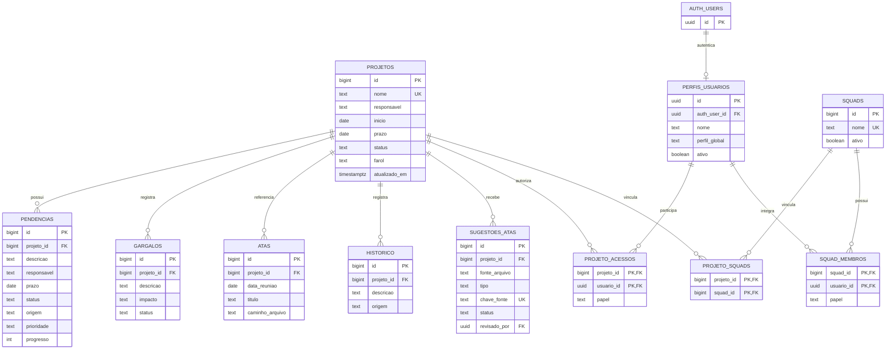
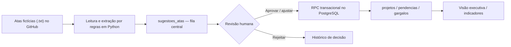
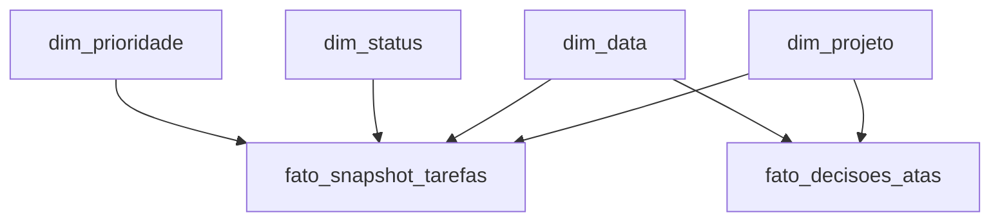

# Modelagem de dados — Gerenciamento de Projetos com IA

> **Estado atual (outubro/2026):** banco operacional **PostgreSQL relacional**, hospedado no **Supabase**. Este documento representa as tabelas e relacionamentos verificados no ambiente; não é um script de recriação do banco. Não contém dados pessoais, chaves ou credenciais.

## 1. Diagrama entidade-relacionamento (OLTP)

**Nota:** `auth.users` pertence ao schema gerenciado pelo Supabase Auth. `app_private.admin_allowlist` e as tabelas privadas de auditoria não são expostas como dados de domínio na API pública. A coluna `revisado_por` da fila aponta para `auth.users`.

## 2. Organização lógica

| Domínio | Tabelas | Responsabilidade |
|---|---|---|
| Portfólio | `projetos` | Identidade, responsável, datas e estado do projeto |
| Execução | `pendencias`, `gargalos` | Tarefas, prioridades, progresso, bloqueios e riscos |
| Reuniões | `atas`, `sugestoes_atas`, `historico` | Referências de atas, propostas de atualização e rastreabilidade |
| Identidade e autorização | `perfis_usuarios`, `projeto_acessos` | Perfil interno e acesso explícito por projeto |
| Colaboração | `squads`, `squad_membros`, `projeto_squads` | Relações muitos-para-muitos entre pessoas, squads e projetos |

### Regras e decisões arquiteturais

- **Chaves primárias e estrangeiras** asseguram vínculos entre projetos, tarefas, squads e usuários.
- **Tabelas associativas** resolvem relações muitos-para-muitos, evitando listas de IDs em colunas de texto.
- **Tipos**: `bigint` para entidades operacionais; `uuid` para identidade; `date` para prazos; `timestamptz` para rastreabilidade.
- **Restrições `CHECK`** limitam valores de status, prioridade, progresso e impacto.
- **`sugestoes_atas.chave_fonte` é única**, ajudando a não duplicar propostas originadas do mesmo trecho de ata.
- **RLS (Row Level Security)** habilitada nas tabelas de negócio: a consulta depende das permissões do usuário autenticado.
- **Aprovação transacional**: a função `aplicar_sugestao_ata` utiliza uma transação de banco para aplicar a alteração e registrar a decisão como uma operação indivisível.
- **As atas de demonstração são arquivos TXT públicos no GitHub**, e não registros persistidos na tabela `atas`; esta última está preparada para evolução do domínio.

## 3. Fluxo de dados

**Limite funcional:** a extração é baseada em prefixos e regras textuais; não há evidência de uso de um modelo generativo/LLM em produção. A atualização depende de aprovação, e o vínculo com a tarefa existente é selecionado pelo revisor.

## 4. Evolução proposta: camada analítica dimensional (não implementada)

Para evoluir BI sem comprometer o modelo transacional, a proposta é criar **um data mart separado** (ou schema `analytics`) com cargas controladas:

- **Grão de `fato_snapshot_tarefas`**: uma linha por tarefa por data de observação. Métricas: quantidade, progresso, vencimento e atraso.
- **Grão de `fato_decisoes_atas`**: uma linha por sugestão revisada. Métricas: quantidade aprovada/rejeitada, tempo de revisão e categoria.
- **Dimensões**: projeto, data, status e prioridade, com chaves substitutas quando fizer sentido.
- **Benefícios**: séries históricas, análise de SLA, tendências de atraso e relatórios Power BI.
- **Cuidados**: LGPD, minimização de dados pessoais, pseudonimização de responsáveis, acesso por perfil e retenção definida.

> A modelagem dimensional é um **roadmap de engenharia de dados**, não uma funcionalidade já disponível no aplicativo.
